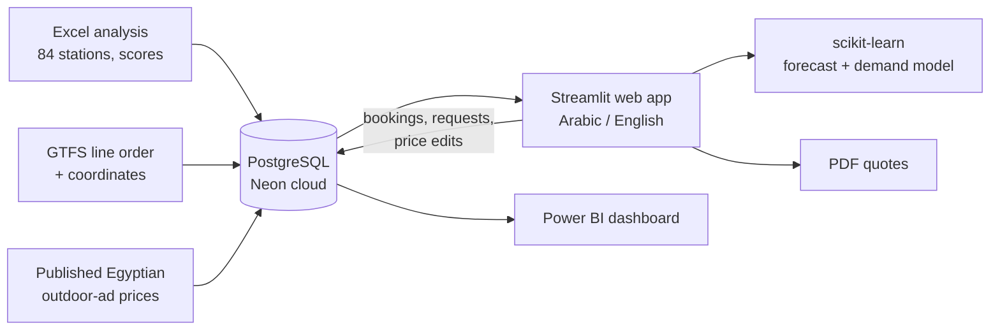

# 🚇 Cairo Metro Ad Planner · مخطط إعلانات مترو القاهرة

**An end-to-end data project:** an Excel analysis of Cairo Metro's 84 stations became a PostgreSQL database, a live
bilingual web app (Arabic / English) with machine-learning forecasts, and a Power BI dashboard, all reading the same
cloud database.

**▶ Live app:** [Arabic](https://cairo-metro-ad-planner-mwzqpnn7ozdv8uubvti5wu.streamlit.app) ·
[English](https://cairo-metro-ad-planner-mwzqpnn7ozdv8uubvti5wu.streamlit.app/?lang=en)

---

## The problem
An advertiser with a budget wants to reach a specific audience on the metro. Which stations, which ad formats, and
what will it cost? And the metro side wants to know: which spaces sell, which sit empty, and what revenue is coming next.

## What I built



| Page | What it does |
|---|---|
| **Dashboard** | Revenue, today's occupancy, live campaigns, revenue by month, line, format, station and advertiser. Refreshes every 5 minutes. |
| **Plan & book** | Pick industry, audience, budget and dates; a recommender picks the best *available* spaces, shows them on a map, and books them or downloads a **PDF quote** (Arabic or English). |
| **Request a space** | Public form: choose a station and spaces, **verify your email with a 6-digit code**, and the request is held as *pending* for review. |
| **Insights** | Occupancy month by month, occupancy by format × station tier, spend by industry and advertiser, and the least-booked spaces with a suggested action. |
| **Forecasts** | Revenue forecast for the next 3–12 months, a demand model that explains what makes a space get booked, and a **price simulator** (what happens to occupancy and revenue if prices change). |
| **Network** | All three lines and both Line 3 branches, plus **K-means station segments** on a map, each with the advertisers it suits. |
| **Station** | One station's profile and audience, a **booking calendar** (Gantt) showing what's free, and the live status of each ad space. |
| **Prices** | Price range per format and the published source behind it. |
| **Admin** | Password protected: approve or cancel bookings and requests, add campaigns, edit prices. |

## Machine learning
- **Revenue forecast:** ridge regression on trend + calendar-month seasonality. Revenue is counted in the months an ad
  actually runs. Accuracy is checked with a **back-test** (the model is re-trained without the last 3 months and
  scored on them), and the forecast shows an 80% range.
- **Demand model:** gradient boosting predicts each space's 12-month occupancy from station riders, ad score,
  purchasing power, format, zone, price and area type. Accuracy is **5-fold cross-validated** (R² ≈ 0.5), and
  **permutation importance** ranks the drivers. Spaces far below their prediction are flagged as under-performing;
  spaces far above it may support a higher price.
- **Price simulator:** busy stations cost more *and* sell more, so an unconstrained model learned that higher prices
  raise demand. Price is therefore a **monotonic feature** (a higher price can never increase predicted demand),
  with about the same accuracy, so the model can answer "what if we cut digital-screen prices by 10%?".
- **Station segments:** 11 standardised features per station, **K-means** (k = 5, chosen with the silhouette score),
  groups named from their centres (interchange hubs, upscale, commercial & downtown, dense residential, city edge),
  and a PCA view of how they separate.

## SQL
- `01`–`04`, `06`–`08`: the schema built step by step: lines, stations, ad formats, spaces, advertisers, campaigns, bookings.
- **No double bookings:** an `EXCLUDE USING gist` constraint on `(ad_space_id, daterange)` rejects overlapping bookings
  at database level; cancelled bookings free the space.
- `05_sql_analysis.sql`: 17 business questions using CTEs and window functions (`ROW_NUMBER`, `RANK`, `LAG`, `NTILE`,
  running totals).
- `pbi_*` views feed Power BI directly from the cloud database.

## Stack
PostgreSQL (Neon) · SQL · Python · pandas · SQLAlchemy · scikit-learn · Streamlit · Plotly · ReportLab · Power BI

## Run it yourself
```bash
pip install -r requirements.txt
streamlit run app.py
```
Without a `DATABASE_URL`, the sidebar asks for a local PostgreSQL password. To deploy:
1. Create a free Neon database and run `00_cloud_setup.sql` once.
2. On [share.streamlit.io](https://share.streamlit.io), pick this repo with `app.py` as the main file and add the secrets
   `DATABASE_URL` and `ADMIN_PASSWORD`. For email verification add `SMTP_USER` and `SMTP_PASSWORD` (a Gmail app password).
3. In Power BI: Get data → PostgreSQL → the Neon host, database `neondb`, then load the `cairo_metro.pbi_*` views.

## Data notes
- Station facts and ad scores: my own analysis. Daily ridership per station is an **estimate**.
- Line order and coordinates: [Transport for Cairo Metro-GTFS](https://github.com/transportforcairo/Metro-GTFS)
  (CC BY-NC 4.0) and Wikipedia.
- Prices: Cairo Metro does not publish its rate card, so each format is priced inside **published Egyptian
  outdoor-advertising ranges** ([Entasher](https://entasher.com/Blog/190/Cost-of-billboard-advertising-in-Egypt-billboards-in-egypt-price),
  [Alaanak 2025](https://alaanak.com/billboard-price-in-egypt-guide-digital-vs-traditional-options/)). Formats with no
  published price are marked *estimate*.
- Advertisers, campaigns and bookings are **simulated** with invented company names, so the ML results show the
  method, not real advice. This is a portfolio project, not an official Cairo Metro service.

## Author
**Mariam Madbouly** · Data Science graduate ·
[LinkedIn](https://www.linkedin.com/in/mariam-madbouly-32b03a361)
